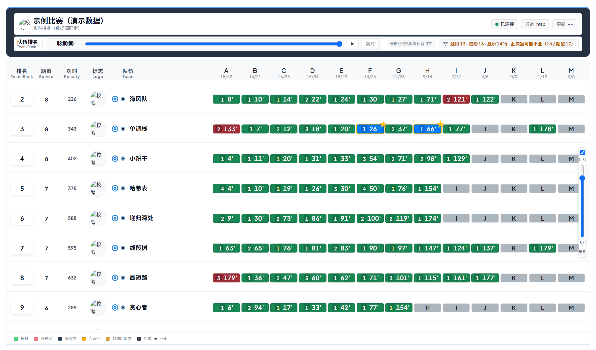
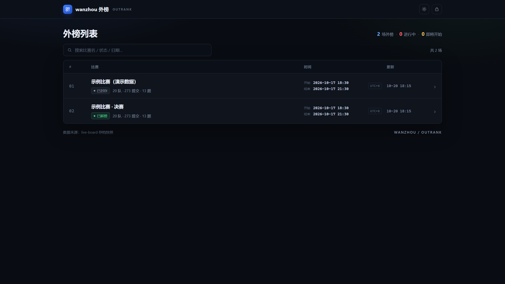
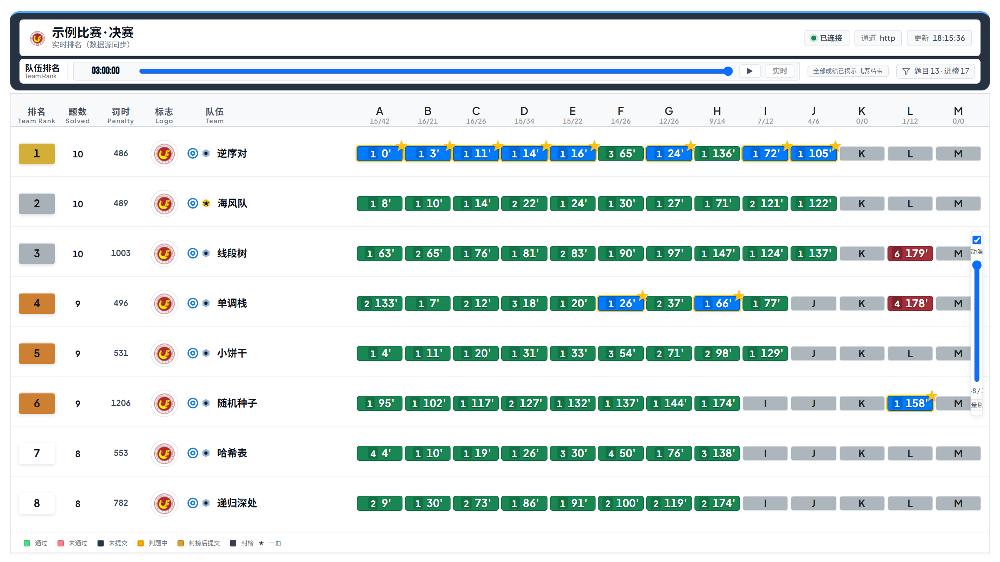

# ScoreDeck

**PTA / VJudge 实时榜单 · 滚榜 · 外榜**

## 项目状态

> **早期版本（beta），不是久经考验的成熟工具。**

- **目前只在一场真实比赛上完整跑通过一次**：PTA 平台、3 小时、20 支队伍、273 次提交、13 道题；写题、封榜、滚榜、外榜存档与解榜全流程都在这场比赛里走通了。
- **三条链路都验证过**：实时榜单（浏览器 / OBS 叠加）、赛后滚榜（ICPC Resolver 比赛包 + 奖项播报）、外榜（存档 + 只读站点 + 解榜）。
- **VJudge 支持（v0.2.0 新增）**：在一场 7 天的 VJudge 题单（39 题 / 7 支队伍）上验证了抓取、实时榜、队伍备注（真实姓名 / 校徽）；**罚时、解题数与 VJudge 网页逐队对齐**。VJudge 的封榜设置、题目标题接口不提供，详见 `docs/VJudge使用说明.md`。
- **还没压过的场景**：更多赛制 / 更多学校的题库（多题集、跨校合并榜、不同判题行为）、超大榜单（几百支队）、长时间连续运行。
- **已知未验证**：Windows 以外的系统、IE / 老旧浏览器、超过 200 队的榜单性能、断网 / 重连等极端情况。
- **结论**：重要比赛请先在本地空跑一遍，确认榜单、封榜、滚榜结果都对得上，再上正式环境。

---

## 关于 ScoreDeck

ScoreDeck 是一套面向 PTA（拼题 A）比赛的本地榜单工具：比赛进行时把 PTA 的解题数据实时抓下来、在浏览器里渲染成可以给 OBS 用的榜单；比赛结束后把数据打包成 ICPC Resolver 比赛包并播滚榜；赛后还可以把封存的那一刻发布成一个只读的「外榜」网站，供选手和观众回看。

## 适用场景

适合**校内比赛**这一档规模：院系赛、新生赛、集训队选拔、社团内部赛——几十支队伍、两三个小时、十来道题。这类比赛往往没有专职技术组，只要一台能上网的 Windows 机器，就能把「实时看榜 → 封榜 → 赛后滚榜 → 外榜回看」整条链路跑完，投屏、颁奖都能直接对着这套界面用。

如果你要办的是几百支队伍、需要多人协同值守、多机热备和推流级别稳定性的区域赛或省赛，这一版还撑不住：请先等我们补完压力测试，或者自行评估风险。

---

## 界面预览







> 截图里的队伍名、学号均为演示数据。

---

## 支持两个平台

| 平台 | 取数方式 | 需要 Cookie | 说明 |
| --- | --- | --- | --- |
| **PTA（拼题 A）** | 官方页面背后的接口，直连 | 需要（登录后的 JSESSIONID/PTASession） | 原本支持，行为不变 |
| **VJudge** | `contest/rank/single/<比赛ID>` 公开接口 | 公开赛不需要 | v0.2.0 新增；可给选手备注真实姓名 / 校徽，榜单直接显示 |

两个平台产出**同一份 `contest.json`**，所以排名、封榜、滚榜、外榜全部共用一套逻辑，不用分别配置。

## 三个能力

### 1. 实时榜单（比赛进行中）

- 用你自己的 PTA Cookie 直连接口取数（不借用浏览器、不产生下载记录）；
- 本机启动 HTTP/SSE 服务，浏览器打开即可看榜，自动刷新；
- 一整套投屏用 URL 参数：`overlay=1` 透明叠加给 OBS、行数 / 滚动 / 动画 / 缩放 / 主题 / 题格样式都可调；
- 封榜（freeze）之后默认保持观众视角，不泄露最终结果；需要看真实结果时用 `?thaw=1`。

### 2. 赛后滚榜（比赛结束后）

- 把 `contest.json` 生成 ICPC Resolver 2.6 比赛包（`events.xml` + 队伍照片 + 机构校徽）；
- 奖项按「一行一个 `<award>`」的表来配：按名次自动填、按 `*` 自动勾选、或手工勾队；
- 自动拉起 Resolver 播放，Esc 退出守护、日志、子进程清理都已接好；
- 校徽会裁成圆形 PNG、按机构写入比赛包，奖项卡上正确显示。

### 3. 外榜（Outrank，赛后发布）

- 把某一刻的 `contest.json` / `state.json` / 视觉配置冻结成存档；
- 一个**纯只读**的 HTTP 服务把往期比赛列成列表页、单场榜单页；
- 解榜只改存档里的 `revealed` 标记：封存时公网看到的是封榜快照，解榜后看到最终榜；
- 站点无任何写接口，可以放在 nginx 后面用 HTTPS 长期挂着。

---

## 快速开始

### 环境

| 用途 | 需要 |
| --- | --- |
| GUI / 实时榜单 | Python 3.9+（推荐 3.11 / 3.12） |
| 实时榜单取数 | 有效的 PTA Cookie（`JSESSIONID` + `PTASession` 两个都要） |
| 赛后滚榜 | Java 17+，以及 ICPC Resolver 2.6（不随仓库分发，见下） |
| 中文字体（可选） | 任意含中文的 TTF/TTC，或系统自带的微软雅黑 |
| 外榜 | 只需要 Python 标准库 |

### 1. 安装依赖

```bash
python -m pip install -r requirements.txt
```

### 2. 启动图形界面（推荐）

```bash
python app/pta_assistant_gui.py
```

Windows 上也可以直接双击 `scripts/run-liveboard.bat` 只跑实时榜单服务（见第 3 节）。

首次打开后在「1 数据源」页填：

1. **题目集 ID**：PTA 比赛网址 `/problem-sets/<这串数字>`；
2. **PTA Cookie**：浏览器登录后 F12 → Network → 任意 `pintia.cn/api/...` 请求 → 右键「Copy as cURL (bash)」→ 回程序点「粘贴 cURL 自动生成」。

然后按「3 服务 → 启动」，在「4 直播」页复制榜单网址给 OBS 或浏览器。

### 3. 只跑实时榜单（无 GUI）

```bat
scripts\run-liveboard.bat
```

脚本会把 `examples/live-config.example.json` 复制成 `liveboard/config.json`（已存在则不动），然后启动 `server.py + poller.py`。首次运行前需要：

- 把题目集 ID 填进 `liveboard/config.json` 的 `problem_set_id`；
- 把 Cookie 写进 `liveboard/cookie.txt`（一行，两个字段都要）。

默认地址：`http://127.0.0.1:8791/board`。参数见 [docs/参数速查.md](docs/参数速查.md)。

### 4. 跑外榜

```bat
scripts\run-outrank.bat
```

默认读 `data/archives/`、监听 `127.0.0.1:8099`，用 nginx 反代到公网。完整的存档 / 解榜 / 部署流程见 [docs/外榜部署.md](docs/外榜部署.md)。

### 5. 打包 Windows 可执行文件

```bat
scripts\build-windows.bat
```

产物在 `dist/ScoreDeck/`。脚本只使用相对路径，不依赖固定盘符。

> **不随仓库分发的东西**：ICPC Resolver 发行包（第三方，需自行下载并放到 `tools/resolver/app/lib/resolver.jar`）、微软雅黑字体（商业字体，请用你有权使用的字体，GUI 里可以指定任意中文字体）。缺这些时实时榜单仍可正常使用，只有「赛后滚榜」会提示缺失。

---

## 目录结构

```text
scoredesk/
├── app/                 # tkinter GUI：两个模式的窗口、后端胶水、字体/奖项面板
├── core/                # 取数与模型：pta_fetch.py / pta_common.py / pta_to_resolver_xml.py
├── liveboard/           # 实时榜单服务：HTTP/SSE 服务、轮询器、展示与回放
│   └── web/             # 前端：board.html / board.js / board.css / 自托管字体
├── outrank/             # 外榜：只读站点 outrank.py + 存档模块 archive.py
├── scripts/             # Windows 一键脚本（构建 / 实时榜单 / 外榜）
├── examples/            # 脱敏示例配置（不含任何真实比赛数据）
├── docs/                # 使用说明、外榜部署、URL 参数速查、FAQ
├── requirements.txt
├── LICENSE
└── README.md
```

运行期会生成（**都在 .gitignore 里**）：`config.json`、`contest.json*`、`cookie.txt`、`history.json`、`live/`、`logs/`、`tmp/`、`snapshots/`、`data/archives/`、`dist/`、`build/`。

---

## 文档

- [docs/使用说明.md](docs/使用说明.md) —— 从安装到出榜的完整流程
- [docs/参数速查.md](docs/参数速查.md) —— 实时榜单 URL 参数表
- [docs/外榜部署.md](docs/外榜部署.md) —— 存档、解榜、nginx + HTTPS、systemd
- [docs/FAQ.md](docs/FAQ.md) —— 常见问题
- [docs/VJudge使用说明.md](docs/VJudge使用说明.md) —— VJudge 平台：比赛 ID、队伍备注（真实姓名 / 校徽）、已知限制

---

## 反馈

用的时候踩到坑、看到不对的数字、或者有想要的功能，都欢迎开 Issue（也欢迎附上 `.github/ISSUE_TEMPLATE/bug_report.md` 模板里的信息）。

为了能定位问题，请尽量带上这些信息：

1. **系统版本**（例如 Windows 11 23H2 / Ubuntu 24.04）和**浏览器**版本；
2. **用的是哪个功能**：实时榜单 / 赛后滚榜 / 外榜（存档 / 解榜 / 只读站点）；
3. **复现步骤**：点了什么、打开的是哪个网址（`problemSetId` 之类可以保留，Cookie 不要贴）；
4. **期望结果 vs 实际结果**，有截图最好；
5. **截图或日志**：日志一般在程序目录 `logs/` 下，贴之前请先删掉 Cookie、学号、姓名等隐私信息。

> 注意：本工具不是 PTA 官方工具，接口变化或判题行为异常导致的取数问题，需要你自己在本地验证一遍原始数据。

---

## 数据与隐私

- 仓库里**没有任何**真实比赛数据、学生姓名 / 学号、Cookie、校徽或比赛截图；示例配置只用 `Example University`、`张三 / 李四`、`2026001` 这类占位值。
- Cookie 等同登录态，程序只把它存在本机 `cookie.txt`，不会上传；请不要把 `cookie.txt`、`contest.json`、`logs/` 提交到 Git。
- 外榜服务只有 GET 读接口，没有写接口；存档目录由管理员手动同步。

## 第三方组件与许可

- 代码以 MIT 许可发布，见 [LICENSE](LICENSE)。
- `liveboard/web/fonts/` 内的 Web 字体（Noto Sans SC、Plus Jakarta Sans、Bebas Neue、Outfit）来自 Fontsource，均为 SIL Open Font License 1.1，允许随站点分发；许可见该目录下的 `NOTICE.md`。
- ICPC Resolver 由 ICPC 工具组发布，遵循其自身许可，本仓库不包含也不重新分发。
- 微软雅黑等系统字体不随仓库分发，请自行确认使用权。

## License

MIT © ScoreDeck contributors
